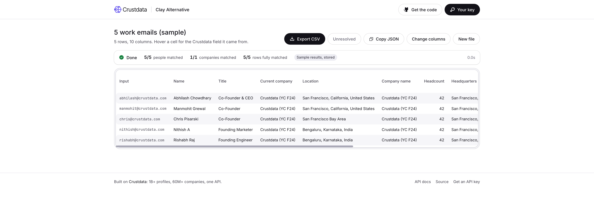

# Clay Alternative: open-source CSV lead enrichment on the Crustdata API

_Part of [crustdata/tools](https://github.com/crustdata/tools), open-source agents and tools built on the Crustdata API._

**Clay Alternative is an open-source, self-hosted alternative to Clay and to Firecrawl's fire-enrich: drop a CSV of work emails, company domains or profile URLs and it fills in person and company columns (title, current company, location, headcount, industry, funding, last round, open roles, tech stack and more) from [Crustdata](https://crustdata.com), the B2B data API with 1B+ profiles and 60M+ companies.** One API key, no AI key, every cell traceable to a Crustdata field, free company resolution and free misses, a CLI with a cache that never pays twice, and a credit estimate before the first paid call.

**What it costs:** company name, headcount, industry, headquarters, year founded and website are free. 1 credit per person found, 2 per company for growth, funding, hiring and the rest, tech stack +2. Misses free. [Details](#what-does-it-cost-per-row).

[](https://vercel.com/new/clone?repository-url=https%3A%2F%2Fgithub.com%2Fcrustdata%2Ftools%2Ftree%2Fmain%2Fclay-alternative&env=CRUSTDATA_API_KEY&envDescription=Your%20Crustdata%20API%20key&envLink=https%3A%2F%2Fapp.crustdata.com&project-name=clay-alternative&repository-name=clay-alternative) One setting, your Crustdata key. Or `git clone` and `npm run dev`: [Quickstart](#quickstart).



**Contents:** [What it does](#what-it-does) · [How to build a CSV enrichment tool](#how-to-build-a-csv-enrichment-tool) · [Open-source alternative to Clay and fire-enrich](#open-source-alternative-to-clay-and-fire-enrich) · [Quickstart](#quickstart) · [Which columns can I add?](#which-columns-can-i-add) · [What does it cost per row?](#what-does-it-cost-per-row) · [How do I enrich emails, domains, profile URLs or names?](#how-do-i-enrich-emails-domains-profile-urls-or-names) · [How do I get work emails?](#how-do-i-get-work-emails) · [How do I find people at my accounts?](#how-do-i-find-people-at-my-accounts) · [How do I resume an interrupted run?](#how-do-i-resume-an-interrupted-run) · [Where does the data come from?](#where-does-the-data-come-from) · [Limits](#limits) · [The JSON API](#the-json-api) · [FAQ](#faq) · [Configuration](#configuration) · [Commands](#commands) · [Deploy](#deploy) · [Data and security](#data-and-security) · [Project structure](#project-structure) · [Built on Crustdata](#built-on-crustdata)

## What it does

| You give it | It works out | It fills in |
|---|---|---|
| A CSV from HubSpot, Salesforce, Attio, Apollo or Sheets, or a pasted list | Which column holds the email, the domain or the profile URL, and which identifier each row has (profile URL, then work email, then domain, then company name) | Person columns from the profile, company columns from the company record, one call per unique person and one per unique company; rows that share an identifier are all kept and filled from one lookup |
| `jane@acme.example` | The person by the address, the company by the domain `acme.example` (or by the employer on the profile when the address's domain is not the company's own) | Both |
| `acme.example` or `https://www.acme.example/pricing` | The company | Company columns |
| A profile URL (`.../in/example-jane-doe`) | The person, then the current employer from the profile | Both |
| `lee@gmail.com` | The person; the company comes from the profile, not the address | Both, with the row marked "personal email" |
| `Acme Analytics` (a name only) | The company, when there is exactly one clear match; otherwise "ambiguous", never a guess | Company columns |
| `Jane`, `Doe`, `Acme Analytics` (a person's name and company, no email or URL) | The company from its name when the match is clear; nothing for the person, name-only matching is not in this version | Company columns; the person cells say "no identifier" and the row counts on its company alone |

Before the first paid call you see the estimate ("312 rows, 140 companies, 300 people: up to 580 credits (you have 9,420)"); after the run, the real total from Crustdata's `x-credits-used` header and your credits left. Each cell shows its match status (matched, not found, ambiguous, redacted, needs access, no identifier, invalid) and, on hover, the endpoint, the field path it was read from and the fetch date. Export keeps your original columns, adds the new ones, and appends `_match_status`, `_match_confidence` and `_source_row`; a second file lists the unresolved rows with the reason and the line number so you can fix those and run just that file again.

## How to build a CSV enrichment tool

A data enrichment tool for leads (a CSV enrichment tool, a Clay-style table) is three steps on top of a data API that can resolve an identifier to a record: read the rows and decide what identifies each one, resolve each identifier to a person or a company, then read the fields you want out of those records. With Crustdata the resolution step is free for companies and the misses are free for people, so the tool only pays for records it actually fills. This repo is that method in TypeScript, as a web page, a JSON API and a CLI on one engine.

1. **Read the CSV and classify every row.** Recognise the CRM's column names (`Email Address`, `Website URL`, `Company Domain Name`, `Account Name`, `First Name` + `Last Name`), strip the BOM, accept `;` and tab files, merge duplicates, keep the real line number of every row. Normalise identifiers so `Stripe.com/`, `www.stripe.com` and `https://stripe.com` are one company (`lib/csv.ts`, `lib/normalize.ts`).
2. **Plan before you pay.** Group rows by identifier: unique profile URLs and emails go to person enrich, unique domains and names to company identify. Read your prices and rate limits from `GET /account/endpoints` (free) and show the estimate (`lib/plan.ts`).
3. **Resolve companies for free.** `POST /company/identify` with up to 25 domains or names returns the Crustdata company id plus name, website, description, year founded, headcount, headquarters and industries at no cost. Accept a domain match only when the record's own domains include the one you asked for (hosted sites come back with full confidence otherwise), and a name only with one clear winner.
4. **Enrich in batches of 25, cache every result.** `POST /company/enrich` with the company ids and only the field groups your columns need (2 credits per company, once, whatever the columns). `POST /person/enrich` with profile URLs or business emails (1 credit per match, misses free). Save each result keyed by identifier and field group so a second run, or a run resumed after an interruption, pays nothing (`lib/run.ts`, `lib/cache.ts`).
5. **Fill the cells from field paths, never from guesses.** Each column is `{ endpoint, field group, path, pick(record) }`; a missing value stays empty and says so (`lib/columns.ts`).

The core request, a company resolved and enriched in two calls:

```bash
curl -s https://api.crustdata.com/company/identify \
  -H "authorization: Bearer $CRUSTDATA_API_KEY" \
  -H "x-api-version: 2025-11-01" \
  -H "content-type: application/json" \
  -d '{"domains": ["acme.example"]}'
# -> [{ "matched_on": "acme.example", "matches": [{ "confidence_score": 1.0,
#      "company_data": { "crustdata_company_id": 100001,
#        "basic_info": { "name": "Acme Analytics", ... },
#        "headcount": { "total": 240 }, "locations": { "headquarters": "..." } } }] }]
# 0 credits

curl -s https://api.crustdata.com/company/enrich \
  -H "authorization: Bearer $CRUSTDATA_API_KEY" \
  -H "x-api-version: 2025-11-01" \
  -H "content-type: application/json" \
  -d '{"crustdata_company_ids": [100001], "fields": ["headcount", "funding", "hiring"]}'
# -> the field groups asked for; 2 credits, reported in the x-credits-used header
```

And a person by work email (1 credit if matched, free if not):

```bash
curl -s https://api.crustdata.com/person/enrich \
  -H "authorization: Bearer $CRUSTDATA_API_KEY" \
  -H "x-api-version: 2025-11-01" \
  -H "content-type: application/json" \
  -d '{"business_emails": ["jane@acme.example"], "fields": ["basic_profile", "experience"]}'
# -> [{ "match_status": "matched", ... }]; 1 credit if matched, 0 if not_found
```

Every request and response the tool makes is in [docs/how-it-works.md](docs/how-it-works.md).

## Open-source alternative to Clay and fire-enrich

Compared on 21 October 2026 against [Clay](https://clay.com) and [fire-enrich](https://github.com/firecrawl/fire-enrich); open an issue if a cell is out of date.

| | Clay | fire-enrich (Firecrawl) | Clay Alternative (this repo) |
|---|---|---|---|
| What it is | A hosted spreadsheet with 100+ data providers, AI columns and CRM sync | An open-source web app you deploy: emails in, company fields out, found by web search and extracted by an OpenAI model | An open-source web app and CLI you deploy: emails, domains or profile URLs in, person and company fields out, read from Crustdata records |
| Keys needed | A Clay account and credits | Firecrawl and OpenAI | One Crustdata key |
| Identifiers accepted | Email, name, company, domain, profile URL and more | Email (the domain is derived from it) | Work or personal email, company domain, profile URL, company name; not a person's name alone |
| Person columns | Yes | Not as standard fields; a custom field can ask the agent for them | Yes: title, company, location, seniority, skills, education, past employers, profile URL; work email when contact data is enabled on your plan |
| Company columns | Yes | Yes: description, industry, headcount, founded, HQ, funding, tech stack, custom fields in plain English | Yes: 28 columns from firmographics, headcount and growth by department, funding and investors, hiring, web traffic, founders and executives, tech stack |
| Contact data | Emails and phones through several providers | No | Work email with contact access on your plan; no phones or personal emails in this version |
| Where a value comes from | Provider by provider | A web page, cited per cell | A field path in a Crustdata record, shown on hover with the fetch date; a model never writes a cell |
| Cost per row | Credits across providers | Several web searches plus a model call per row | Company 2 credits once per domain, person 1 per match; resolution and misses free; repeats free in the CLI |
| Free-text custom columns | Yes (AI) | Yes (AI) | No: columns are a fixed catalogue you extend in code |
| Waterfall across providers | Yes | No | No (one provider; inside Crustdata the cheapest call runs first: free identify, then enrich, email domain, then the employer on the profile) |
| Intent and signals | Yes | No | No (see [Prospecting Agent](../prospecting-agent/) for Crustdata watchers) |
| CRM write-back and dedupe | Yes | No | No: export CSV (HubSpot, Salesforce and Attio import it); rows are deduped within the file only |
| Big files | Yes | Browser only; the hosted demo is capped at 15 rows, your own copy is not | CLI with a SQLite cache and resume; batch endpoints documented for 10,000+ |
| Self-hosted | No | Yes (Vercel button) | Yes (Vercel button, Railway, Render, plain Node) |

## Quickstart

You need Node 22.13 or newer and a [Crustdata API key](https://app.crustdata.com).

```bash
git clone --depth 1 https://github.com/crustdata/tools   # this app is one folder of it
cd tools/clay-alternative
npm install
cp .env.example .env        # set CRUSTDATA_API_KEY
npm run dev                 # http://localhost:3218
```

On the page: drop a CSV (or paste a list, or click one of the three samples: 5 work emails, 10 company domains, 5 profile URLs), tick the columns, read the estimate, click Enrich, export. The samples replay stored results, so they cost nothing; your own file runs live.

From the terminal, the same job on any file:

```bash
npm run enrich -- leads.csv --dry-run          # the plan and the estimate, no calls
npm run enrich -- leads.csv                    # default columns, asks before paying
npm run enrich -- leads.csv --columns person.title,company.headcount,company.funding_total
npm run columns                                # every column with its cost
npm run replay -- fixtures/emails.json         # offline, against a fake Crustdata
```

Output goes to `out/leads.enriched.csv` and, when rows did not resolve, `out/leads.unresolved.csv`.

## Which columns can I add?

Every column is one Crustdata endpoint, field group and field path. Free columns come from `POST /company/identify`; the paid ones from `POST /company/enrich` (2 credits per company, once, whatever the columns) and `POST /person/enrich` (1 credit per matched person). `npm run columns` prints this table with your account's prices.

| Column | Group | Cost | Source |
|---|---|---|---|
| `person.name`, `person.title`, `person.headline`, `person.location`, `person.country`, `person.department` | Person | 1 per matched person | `/person/enrich` `basic_profile.*` |
| `person.company`, `person.company_domain`, `person.seniority`, `person.start_date`, `person.years_experience`, `person.past_employers` | Person | 1 per matched person (same call) | `/person/enrich` `experience.employment_details.*` |
| `person.education`, `person.skills`, `person.profile_url` | Person | 1 per matched person (same call) | `/person/enrich` `education`, `skills`, `social_handles` |
| `person.email` | Person | +1 per person with an email; needs contact access | `/person/enrich` `contact.business_emails[].email` |
| `company.name`, `company.domain`, `company.website`, `company.description`, `company.year_founded`, `company.headcount`, `company.employee_range`, `company.hq`, `company.country`, `company.industry`, `company.type` | Company | Free | `/company/identify` `basic_info.*`, `headcount.total`, `locations.*` |
| `company.headcount_growth_3m`, `company.headcount_growth_6m`, `company.headcount_growth_12m`, `company.headcount_by_department` | Company | 2 per company, once | `/company/enrich` `headcount.*` |
| `company.funding_total`, `company.last_round_type`, `company.last_round_date`, `company.last_round_amount`, `company.investors` | Company | 2 per company (same call) | `/company/enrich` `funding.*` |
| `company.open_roles`, `company.hiring_growth_12m`, `company.hiring_titles` | Company | 2 per company (same call) | `/company/enrich` `hiring.*` |
| `company.web_traffic`, `company.categories`, `company.founders`, `company.executives` | Company | 2 per company (same call) | `/company/enrich` `web_traffic`, `taxonomy`, `people` |
| `company.tech_stack` | Company | +2 per company | `/company/enrich` `technographics.top_technologies` |

Default ticks: name, title, current company, location; company name, headcount, industry, headquarters, total funding, last round. Adding a column is one entry in `lib/columns.ts` and one test: see [docs/customize.md](docs/customize.md).

## What does it cost per row?

Credits, at Crustdata list prices (your account's prices are read live and shown on the page and in `npm run columns`):

- Resolving a company from a domain or a name (a record with name, headcount, HQ, industry, year founded, website): **free**. Rows with no domain of their own (profile URLs, personal emails) pay **one person lookup** to read the employer from the profile first.
- Company columns beyond those: **2 credits per unique company**, once, however many columns. Tech stack **+2**.
- Person columns: **1 credit per matched person**; not found and redacted are **free**. Work email **+1** per person with one.
- Repeats: **free in the CLI**, which caches every result in `data/cache.sqlite` (records older than `--max-age` days, default 30, are fetched again). On the web the cache lives in the server's memory for `CACHE_TTL_HOURS` (default 24) and does not survive a serverless cold start, so re-run the unresolved file, not the whole file.

Worked example: a 1,000-row CSV of work emails at 400 unique domains, with person columns and paid company columns: up to 1,000 person credits (less whatever does not match) plus 400 companies × 2 = 800, so **up to 1,800 credits**, or 2,800 with the work email column at 1 per person found. The same file with free company columns only (name, headcount, HQ, industry) and no person columns: **0 credits**. The estimate on the page and in `--dry-run` is this arithmetic on your file before anything is called; the cost bar after is the sum of `x-credits-used`.

Two things the estimate cannot know before the run, both stated under it: a profile URL or personal email row counts as one company each until the profile names the employer, so a list of 500 people at 20 accounts estimates 500 companies and bills 20; and a work email whose domain is not the company's own (a `.co` beside the `.com`, a brand domain) adds one company profile on top, found through the profile (and, when no person columns are ticked, one person lookup to read it; the estimate counts those as the worst case). `--max-credits N` (or `MAX_CREDITS_PER_RUN`) stops the run before its next call; it can be passed by one batch of each phase, see [How do I resume an interrupted run?](#how-do-i-resume-an-interrupted-run).

## How do I enrich emails, domains, profile URLs or names?

- **Work emails.** `POST /person/enrich` with `business_emails` resolves the person (1 credit per match). The company comes from the address's domain through the free identify call; when that domain is not the company's own (a brand domain, a `.co` next to a `.com`), the tool falls back to the employer on the profile. One malformed address would fail the whole batch of 25, so the tool pulls it out first and lists it with its line number.
- **Personal emails** (gmail, outlook, ...) still resolve the person; the company comes from the profile, and the row is marked "personal email".
- **Domains.** `POST /company/identify` with up to 25 `domains` (free), then `POST /company/enrich` for the paid columns. A match is accepted only when the record's own domains include the one asked for; a site hosted on a platform domain is reported as not found with the closest name, not matched to the platform.
- **Profile URLs.** `POST /person/enrich` with `professional_network_profile_urls`; the current employer's domain on the profile then goes through the company steps, so a list of profile URLs gets company columns too.
- **Company names.** `POST /company/identify` with `names`. Crustdata returns namesakes with full confidence, so a name is accepted only when exactly one record has that name, or one has at least 10 people and is at least three times larger than the next; otherwise the row is "ambiguous: add a domain".
- **Name + company only** (no email, no URL): the company columns are filled from the company name when it matches clearly; the person cells stay "no identifier", and the estimate warns how many rows are in that position. Add an email or a profile URL column to get person columns.

Some keys cannot look people up by email at all (the API answers 403). The page checks yours with one free call and warns before the run; the CLI's `npm run status` shows it as "Email lookup". Profile URL rows always work.

## How do I get work emails?

Tick the `Work email` column. It adds `contact.business_emails` to the person call (+1 credit per person with an email) and picks the deliverable address at the current employer. Contact data needs enabling on your Crustdata account; self-serve keys do not have it. The tool reads `GET /account/endpoints` (free) and shows the column as "needs contact access" when your key lacks it, instead of failing mid-run; the CLI refuses the column with the same sentence. To get it enabled, write to Crustdata from [crustdata.com](https://crustdata.com). Phone numbers are a premium field too (2 credits) and are not offered in this version: [docs/customize.md](docs/customize.md) shows the one-line change.

## How do I find people at my accounts?

```bash
npm run find-people -- --domain acme.example --titles "VP Sales, Head of Marketing" --limit 5
```

resolves the company (free), runs `POST /person/search` filtered on the current employer's Crustdata id and your titles (about 0.03 credits per search result at list price; the search asks for three times `--limit` so the title check has candidates, so `--limit 5` costs about 0.45 credits), checks the titles again in code (the search matches any current role), drops advisors and interns, and writes `out/people-acme.example.csv` with name, title, company, website, profile URL, seniority and location, ready for `npm run enrich`.

## How do I resume an interrupted run?

Run the same command again. The CLI saves every result to `data/cache.sqlite` after every batch of 25, keyed by identifier and field group, so the second run reads what the first already paid for and only calls Crustdata for the rest; a third run bills 0. Misses are cached too. `--refresh` forces new calls; `--max-age 7` re-fetches anything cached more than a week ago (default 30 days); `--max-credits N` (or `MAX_CREDITS_PER_RUN`) stops a run before its next call once N credits are spent (people and companies run side by side, so it can be passed by one batch of each: at most 25 people and 25 companies, 150 credits at list price with every column ticked). On the web, the cache lives in the server's memory for `CACHE_TTL_HOURS` and does not survive a serverless cold start: export the table before you leave the page, and re-run the unresolved file rather than the whole file.

## Where does the data come from?

From [Crustdata](https://crustdata.com): company and people data, 1B+ profiles and 60M+ companies, searchable, enrichable and watchable through one API. This tool uses four endpoints: `POST /company/identify` (free), `POST /company/enrich`, `POST /person/enrich` and, for find-people, `POST /person/search`. Prices and rate limits come from `GET /account/endpoints`. Docs: [docs.crustdata.com](https://docs.crustdata.com) ([llms.txt](https://docs.crustdata.com/llms.txt)).

## Limits

- 25 identifiers per call; 15 calls a minute on `/company/enrich` and `/person/enrich`, 30 on `/company/identify` (your account's limits are read live). That is about 375 people or companies a minute. The tool paces calls under the limit and retries 429 and 5xx with backoff; a paid call whose response arrived is never retried.
- On the web, one run is capped at `MAX_ROWS_PER_RUN` rows (default 500) because a Vercel request has five minutes. The CLI has no cap. Above about 2,000 rows, Crustdata's batch endpoints (10,000 identifiers per job) are the better tool: see [docs/customize.md](docs/customize.md).
- Company-name rows are matched conservatively (see above). Rows with only a person's name and company are not matched in this version. `_match_confidence` is Crustdata's score for the record; for domains the tool's own-domain check decides the match, so a 1.0 means the record's domains include yours.
- A field group your key cannot read is dropped from the call and the column says "needs access" rather than failing the run.

## The JSON API

Three routes, the same engine the page uses:

- `POST /api/enrich` with `{ "rows": [{ "line": 2, "cells": { "Email": "jane@acme.example" } }], "columns": ["person.title", "company.headcount"] }` streams NDJSON events: `start` (the estimate), `cells` (one row's new cells with status and source), `progress`, `cost`, `note`, `error`, `done` (the summary, the real total, credits left). Add `"dryRun": true` for the estimate alone.
- `GET /api/columns`: the catalogue with the cost per row at the caller's prices.
- `GET /api/check`: whether a deployment key exists, whether credits are shown, the row cap, and the key's credits and access.

A visitor's own key goes in the `x-crustdata-key` header and is used for that request only. On the deployment's key, `/api/check` and `/api/columns` take 30 requests a minute per address and `/api/enrich` 30 runs per 10 minutes; a visitor's own key is not limited.

```bash
curl -N http://localhost:3218/api/enrich -H "content-type: application/json" \
  -d '{"rows":[{"line":2,"cells":{"Website":"acme.example"}}],
       "columns":["company.name","company.headcount"]}'
```

## FAQ

### Is there an open-source, self-hosted alternative to Clay?

Yes: Clay Alternative, in this repo, is an open-source, self-hosted CSV enrichment tool built on the Crustdata API. It covers Clay's core loop (a table of leads in, person and company columns filled in, a table out) on one API key, with no AI key, a cost estimate before the run, and a CLI whose cache never pays twice on big files. It does not do Clay's AI columns, 100+ provider waterfall or CRM sync.

### Is there an open-source alternative to fire-enrich?

Yes. fire-enrich (Firecrawl) needs Firecrawl and OpenAI keys, fills company fields only (the email is just a way to a domain) and cites web pages. Clay Alternative needs one Crustdata key, fills person columns as well as company columns, reads every cell from a field in a Crustdata record rather than from a page, resolves companies for free, and runs from the command line on files too big for a browser tab.

### How do I enrich a CSV of emails with company data?

Drop the CSV on the page (or `npm run enrich -- file.csv`). The tool finds the email column, derives the company from each address through Crustdata's free `POST /company/identify`, enriches each unique company once with `POST /company/enrich`, and fills headcount, industry, headquarters, funding, open roles and the rest for every row at that company.

### What is waterfall enrichment and does this do it?

Waterfall enrichment tries sources in order and stops at the first hit, so you pay for the cheapest source that answers. Inside Crustdata this tool does that: the free identify call before any paid call, one enrich per unique company rather than per row, the email's domain before the employer on the profile, and the cache before everything. Across providers it does not: the provider surface is one TypeScript type with one implementation, and [docs/customize.md](docs/customize.md) shows where a second would go.

### Is there a Clay alternative that works without AI?

Yes, this one. There is no model in the pipeline: every cell is a field read from a Crustdata record, which is also why there are no free-text custom columns. You need one Crustdata API key and no OpenAI or Anthropic key.

### Is there a free Clay alternative?

The software is free (MIT). Running it costs Crustdata credits per row: company name, headcount, industry, headquarters, year founded and website are free through `POST /company/identify`, the other company columns are 2 credits per unique company, and person columns are 1 credit per matched person. A 1,000-row file of domains with free company columns only costs 0 credits.

### How much does Clay cost compared with this?

Clay is priced per seat and per month, with credits spent provider by provider for each cell. Clay Alternative has no seat or subscription: you pay Crustdata credits per unique record (2 per company, 1 per matched person, 0 for identify, misses and CLI repeats), and the estimate is shown before the first paid call. Check Clay's pricing page for its current plans; this README does not quote them.

### How do I enrich leads with headcount and funding?

Drop a CSV with an email or website column, tick Headcount (free, from `POST /company/identify`) and Total funding and Last round (2 credits per unique company, from `POST /company/enrich` `funding.*`), click Enrich. Every row at the same company is filled from one call. From the terminal: `npm run enrich -- leads.csv --columns company.headcount,company.funding_total,company.last_round_type`.

### How do I enrich a CSV of profile URLs?

Put the URLs in a column called Profile URL (CRM export headers are recognised too). Each URL goes to `POST /person/enrich` with `professional_network_profile_urls` (1 credit per match, misses free); the current employer's domain on the profile then goes through the free company identify call, so you get company columns too.

### Which lead enrichment API does it use, and can I call it directly?

Crustdata's. Three endpoints do the enrichment: `POST /company/identify` (free, domain or name to a company record), `POST /company/enrich` (2 credits per company) and `POST /person/enrich` (1 credit per matched person, by work email or profile URL). You can call them from your own code with the curl examples above, or call this repo's `POST /api/enrich`, which wraps them and streams a row at a time.

### What does a 1,000-row file cost?

Up to 1,000 credits for person columns (1 per matched person, misses free) plus 2 per unique company for paid company columns. 1,000 emails at 400 domains with both: up to 1,800 credits. Free company columns only: 0. See [What does it cost per row?](#what-does-it-cost-per-row).

### Can it enrich a list of names and companies?

Partly. A row with a person's name and a company name but no email or profile URL gets the company columns (the name is resolved through the free identify call when exactly one record carries it) and no person columns: matching a person by name alone is not in this version, and the estimate says how many rows are in that position. Add an email or a profile URL column for the person columns, or use `npm run find-people` to pull the people at those companies by title.

### Can I get phone numbers?

Not in this version. `contact.phone_numbers` is a premium field on the same person call (2 credits per person) that, like work emails, needs contact data enabled on your Crustdata account. [docs/customize.md](docs/customize.md) shows the change.

### Does it push to HubSpot or Salesforce?

No. Export the CSV and import it: match on the email column, map each new column to a property (HubSpot asks you to create a property for a header it does not know, for example "Headcount" as a number and "Last round" as text; a header that already existed in your export gets a "(Crustdata)" suffix so the two never collide), and skip `_match_status`, `_match_confidence` and `_source_row` or map them to notes. There is no write-back and no dedupe against the CRM; rows are deduped within the file only.

### Is my data stored anywhere?

Nothing is written to disk by the server. The page holds the table in the browser; the server keeps the records it fetched in memory, per key, for `CACHE_TTL_HOURS` (default 24, 0 to turn it off), so everyone using the same deployment key shares that cache; the CLI writes to `out/` and caches to `data/` on your machine. Keys are never logged.

## Configuration

| Setting | Default | What it does |
|---|---|---|
| `CRUSTDATA_API_KEY` | | Your key. The CLI needs it; the page runs on it unless a visitor pastes their own. |
| `SHOW_CREDITS` | `true` | `false` hides credit numbers from visitors who have not pasted a key (rows and companies are still shown). |
| `MAX_ROWS_PER_RUN` | `500` | The most rows one run on the page may enrich. Bigger files are cut to this and pointed to the CLI. |
| `MAX_CREDITS_PER_RUN` | off | Stop a run before its next call once it has spent this much (can be passed by one batch of each phase: at most 25 people and 25 companies). |
| `CACHE_TTL_HOURS` | `24` | How long the web server keeps fetched records in memory, per key; `0` turns the server cache off. |
| `DAILY_CREDIT_CAP` | off | Credits the deployment's key may spend per UTC day across visitors. Per server process: not reliable on serverless hosts, see Deploy. |
| `ALLOW_SERVER_KEY` | `true` | `false` makes every visitor paste their own key. |
| `CACHE_PATH` | `data/cache.sqlite` | Where the CLI cache lives. |
| `BASE_PATH` | | Serve the page under a sub path. |
| `SITE_URL` | | The public URL, for link previews. |

## Commands

| Command | What it does |
|---|---|
| `npm run dev` | The web app on port 3218 |
| `npm run enrich -- <file.csv> [--columns a,b \| --all] [--dry-run] [--limit N] [--refresh] [--yes] [--max-age DAYS] [--max-credits N] [--out dir]` | Enrich a file; writes `out/<file>.enriched.csv` and `.unresolved.csv` |
| `npm run columns` | Every column with its cost per row (your prices with a key, list prices without). `--all` above is every column except Work email and Tech stack |
| `npm run find-people -- --domain x --titles "a, b" [--limit 5]` | The people at a company by title, as a CSV ready to enrich |
| `npm run status` | Key, credits, prices, rate limits, email access, cache size |
| `npm run replay -- fixtures/<case>.json` | Run a saved case offline against a fake Crustdata |
| `npm run samples` | Refresh the stored results behind the page's sample buttons (needs a key) |
| `npm test`, `npm run typecheck` | Offline tests on fixtures, no network; `tsc --noEmit` |

## Deploy

[](https://vercel.com/new/clone?repository-url=https%3A%2F%2Fgithub.com%2Fcrustdata%2Ftools%2Ftree%2Fmain%2Fclay-alternative&env=CRUSTDATA_API_KEY&envDescription=Your%20Crustdata%20API%20key&envLink=https%3A%2F%2Fapp.crustdata.com&project-name=clay-alternative&repository-name=clay-alternative)

One setting, `CRUSTDATA_API_KEY`. The page then runs on your key for whoever can reach the URL, so for a team, turn on Vercel's Deployment Protection (Settings, Deployment Protection, Vercel Authentication or a password) or share the URL inside the team only. For a copy exposed to strangers, set `ALLOW_SERVER_KEY=false` so visitors bring their own key, or `SHOW_CREDITS=false` plus `MAX_ROWS_PER_RUN` and `MAX_CREDITS_PER_RUN`; `DAILY_CREDIT_CAP` and the per-address limit live in server memory and start from zero on every serverless instance, so on Vercel they are not a guarantee. Commercial use of Vercel needs a Pro plan, and the 300-second run limit needs Fluid compute (on by default for new projects). Railway, Render and plain Node: [docs/deploy.md](docs/deploy.md).

## Data and security

The deployment's key is read on the server and never sent to the browser. A visitor's key is held in their browser (or remembered on their device when they tick the box), sent per request in a header, used for that request only and never logged. The server writes nothing to disk; fetched records stay in memory per key for `CACHE_TTL_HOURS`. The CLI's cache and output stay on your machine. CSV cells that start with `=`, `+`, `-` or `@` are escaped on export so nothing runs as a formula in a spreadsheet.

## Project structure

```text
app/            page.tsx (three states on one page), api/enrich, api/columns, api/check
components/     drop zone, column picker, results table, cost bar, key box, top bar
lib/            columns.ts (the catalogue), csv.ts, normalize.ts, plan.ts (pure), run.ts,
                crustdata.ts (the only file that calls Crustdata), account.ts, cache.ts,
                cache-sqlite.ts, export.ts, events.ts, http.ts, find-people.ts
scripts/        enrich, columns, find-people, status, replay, samples
test/           node:test tests on the fixtures, no network
fixtures/       invented companies and people, a messy CSV, an Excel file; responses.json feeds the fake Crustdata
public/samples/ the three sample CSVs and their stored results
docs/           how-it-works.md, customize.md, deploy.md
```

## Built on Crustdata

[Crustdata](https://crustdata.com) is the public data layer for AI and humans: company and people data that is searchable, enrichable and watchable through one API. Docs: [docs.crustdata.com](https://docs.crustdata.com) ([llms.txt](https://docs.crustdata.com/llms.txt)).

| API | Docs |
|---|---|
| Company Identify (free) | [docs](https://docs.crustdata.com/company-docs/identify/introduction) |
| Company Enrich | [docs](https://docs.crustdata.com/company-docs/enrichment/introduction) |
| Person Enrich | [docs](https://docs.crustdata.com/person-docs/enrichment/introduction) |
| Person Search | [docs](https://docs.crustdata.com/person-docs/search/introduction) |

MIT. See [LICENSE](LICENSE).
