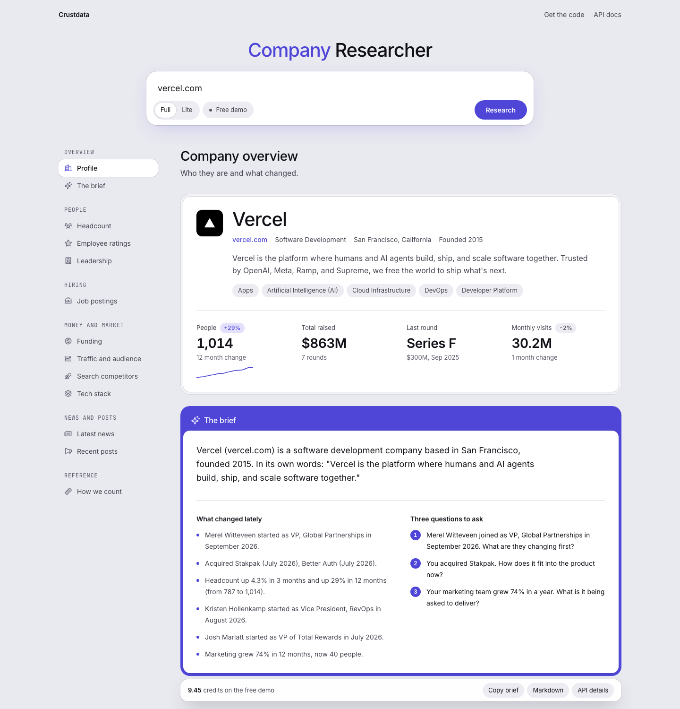

# Crustdata Company Researcher

An open source company research agent: type a company domain or name, get a research brief with headcount by department and location over two years, job postings, executives with start dates, funding, web traffic, tech stack, news, and three questions to ask on a sales call. Built on the [Crustdata](https://crustdata.com) API. It runs as a web app, a JSON API and a command line tool, and it needs nothing but a Crustdata API key.

**Try it:** [crustdata-researcher.vercel.app](https://crustdata-researcher.vercel.app)



## How to build a company research agent

1. **Resolve the company.** `POST /company/identify` turns a domain or a name into a `crustdata_company_id`. Free.
2. **Pull everything about it in one call.** `POST /company/enrich` with the field groups you want: headcount by department and region with growth, funding rounds and investors, executives and decision makers with start dates, web traffic, tech stack, employee ratings, competitors, news, recent posts. 2 credits, plus 2 for the tech stack and 5 for posts.
3. **Add live hiring.** `POST /job/search` for postings in the last 90 days against the 90 before, grouped by title, and the newest 15. About 0.45 credits.
4. **Write the brief from those facts only.** What the company is, what changed lately (layoffs, leadership changes, new executives, funding, acquisitions, headcount and hiring swings), and three questions built from the strongest changes. This repo uses a template, so every sentence points at a field; bring an Anthropic or OpenAI key and a model writes it from the same facts instead.

The core request:

```bash
curl https://api.crustdata.com/company/enrich \
  -H "authorization: Bearer $CRUSTDATA_API_KEY" \
  -H "content-type: application/json" \
  -H "x-api-version: 2025-11-01" \
  -d '{
    "crustdata_company_ids": [631347],
    "exact_match": true,
    "fields": ["basic_info", "headcount", "funding", "people", "web_traffic", "news", "competitors", "employee_reviews"]
  }'
```

`fields` is a whitelist: a group you do not list is not returned. The full pipeline, with every request and response, is in [docs/how-it-works.md](docs/how-it-works.md).

## Example output

`npx tsx scripts/research.ts vercel.com`, run on 16 October 2026, cut for length:

```markdown
# Vercel (vercel.com)

## Brief

Vercel (vercel.com) is a software development company based in San Francisco, founded 2015. In its own words:
"Vercel is the platform where humans and AI agents build, ship, and scale software together." 1,014 people as of
September 2026, up 29% in 12 months and up 71% in 24 months. Engineering is 42% of staff, Sales 11%. 84 job postings
in the last 90 days, down 13% on the 90 days before. Last raised a Series F ($300M) in September 2025. Total raised $863M.

**What changed lately**

- Merel Witteveen started as VP, Global Partnerships in September 2026.
- Acquired Stakpak (July 2026), Better Auth (July 2026).
- Headcount up 4.3% in 3 months and up 29% in 12 months (from 787 to 1,014).
- Kristen Hollenkamp started as Vice President, RevOps in August 2026.
- Marketing grew 74% in 12 months, now 40 people.

**Three questions to ask**

1. Merel Witteveen joined as VP, Global Partnerships in September 2026. What are they changing first?
2. You acquired Stakpak. How does it fit into the product now?
3. Your marketing team grew 74% in a year. What is it being asked to deliver?

## Headcount

| Period    | Change | People added or lost |
|-----------|--------|----------------------|
| 3 months  | +4.3%  | +42                  |
| 12 months | +29%   | +227                 |
| 24 months | +71%   | +422                 |

| Department  | People | Share | 12 month change |
|-------------|--------|-------|-----------------|
| Engineering | 421    | 42%   | +62%            |
| Sales       | 111    | 11%   | +3.7%           |
| Marketing   | 40     | 4%    | +74%            |

## Hiring

84 job postings in the last 90 days (96 in the 90 days before, -13%).
By role type (read from posting titles): Engineering 33, Sales 15, Marketing 10, Data 5, Product and design 5.

## Leadership, Funding, Web traffic, Tech stack, Employee ratings, Search competitors, News, Recent posts
...

Credits used: 9.45 (identify 0, enrich 9, job search 0.45).
```

## What one research returns

| Section | From | What you get |
|---|---|---|
| Profile | `basic_info`, `taxonomy`, `locations` | Name, domain, industry, headquarters, founded, description, logo, public or private or acquired |
| Headcount | `headcount` | Total, growth over 1, 3, 6, 12 and 24 months, by department and by country and metro, monthly series |
| Leadership | `people` | Founders, executives and decision makers with titles, start dates and profile URLs; who started in the last 90 days |
| Hiring | `/job/search` | Postings in the last 90 days against the 90 before, by role type, sales roles, the newest 15 |
| Funding | `funding` | Total raised, every round with lead investors, investors, acquisitions |
| Traffic and audience | `web_traffic`, `followers` | Monthly visits per domain with change, follower growth |
| Search competitors | `competitors` | Sites that bid on or rank for the same searches |
| Tech stack | `technographics` | Tools seen on the site and in job postings, by category |
| Employee ratings | `employee_reviews` | Overall and per topic, flagged when there are too few ratings |
| News and posts | `news`, `social_posts` | Articles from the last 90 days that name the company, its recent posts |
| The brief | all of the above | What it is, what changed lately, three questions to ask |

## How it works

```
domain or name ──> POST /company/identify   to crustdata_company_id                      free
                      │
                      ├──> POST /company/enrich   one call, every field group             2 credits
                      │                                                                    +2 tech stack
                      │                                                                    +5 recent posts
                      │
                      └──> POST /job/search  x3, in parallel                               about 0.45 credits
                             last 90 days grouped by job_details.title     (free: no rows)
                             the 90 days before, count only                (free: no rows)
                             newest 15, sorted by metadata.date_added      (0.03 each)
                      │
                      ▼
                lib/research.ts   shapes the data, writes the brief, caches per company for 24 hours
                      │
                      ├──> web UI   /
                      ├──> JSON     GET /api/research?domain=vercel.com
                      └──> CLI      npx tsx scripts/research.ts vercel.com
```

Things the code handles so you don't have to:

- **Plan limits.** A field group your key cannot read fails the whole enrich call, so the client drops exactly the group named in the error, retries, and shows that section as "not available on this plan".
- **Leadership that is really leadership.** Titles must start with the role ("CEO", "Chief Revenue Officer"), not mention it ("EA to the CEO"). Start dates before the company existed are dropped, and so are founders of other companies and subsidiary or regional titles ranked above the company-wide ones.
- **News that is about this company.** A name that is also an everyday word ("Unify") needs business context in the headline. Signals count only when the company is the subject: "Clay raises $115M" is funding; "Truist raises price target on HubSpot" and "Vercel-backed Photon raises $4.5M" are not.
- **Places.** Region labels overlap ("United States", "California, United States", "San Francisco Bay Area"). They are split into countries and metro areas, one row per metro.
- **Money.** Secondary sales and debt are kept out of the total raised. Ratings from two reviews are flagged, not shown as a score.
- **Retries.** 429 and 5xx responses are retried twice.

## Quickstart (5 minutes)

You need Node 22.13 or newer and a Crustdata API key. Get one at [app.crustdata.com](https://app.crustdata.com): start free with $20 in credits.

```bash
git clone https://github.com/crustdata/tools
cd tools/company-researcher
npm install
cp .env.example .env          # paste your CRUSTDATA_API_KEY

npm run check                              # which data groups your key can read (free)
npx tsx scripts/research.ts vercel.com     # the brief as markdown
npm run dev                                # the web app at http://localhost:3217
```

## What it costs

| Step | Credits |
|---|---|
| `/company/identify` | free |
| `/company/enrich` with every base group | 2 |
| Tech stack add-on (`technographics`) | +2 when the company has data |
| Recent posts add-on (`social_posts`) | +5 when the company has posts |
| `/job/search` aggregations (two calls) | free |
| `/job/search` newest 15 postings | 0.45 |
| **One full research** | **about 9.45** |
| **One lite research** (`--lite`, no tech stack or posts) | **about 2.45** |
| The same company again within 24 hours | free (served from the cache) |

Every response carries the credits it used, read from the `x-credits-used` header: in the CLI footer, in the JSON under `credits`, and in the bar at the bottom of the web page.

## Use it from your own agent

`GET /api/research?domain=` returns the whole result as typed JSON ([lib/types.ts](lib/types.ts), `schemaVersion: "1"`). `&format=md` returns markdown that drops straight into a prompt. A section that failed is listed in `errors`, so "no job postings" and "the job search failed" never look the same.

```bash
curl "http://localhost:3217/api/research?domain=stripe.com&format=md" \
  -H "x-crustdata-key: $CRUSTDATA_API_KEY"
```

Or import it:

```ts
import { research } from "./lib/research";
const r = await research("stripe.com", { lite: true });
console.log(r.brief.questions);
```

| Endpoint | Returns |
|---|---|
| `GET /api/research?domain=` | Everything as JSON. `&format=md` for markdown, `&lite=1` for lite mode. `domain` also takes a company name |
| `GET /api/company?domain=` | Profile and leadership (one enrich call) |
| `GET /api/people?domain=` | Leadership only, from the same cached enrich |
| `GET /api/hiring?domain=` | Hiring (three job search calls) |
| `GET /api/brief?domain=` | The written brief only |
| `POST /api/brief` | The brief from `{ company, people, hiring }` you already have, no Crustdata call |
| `GET /api/check` | Is the key in `x-crustdata-key` valid, and which sections can it read (free) |
| `GET /api/check-ai` | Is the Anthropic or OpenAI key in `x-ai-key` valid, and which model will write the brief (free) |
| `GET /api/config` | Whether this deployment has a demo key and which companies it covers |

## Bring your own keys

The web page has a **Use your own keys** box under the search:

- **Crustdata API key.** The site's own key is a demo key with a daily cap. Visitors paste their own to keep going. Checking a key is free and lists any sections their plan does not include.
- **AI key (optional).** An Anthropic or OpenAI key. With it, the newest model the key can use writes the brief from the data on the page. Without it, the brief comes from the template. If the AI call fails, the template brief is shown with the reason.

Keys stay in the visitor's browser (in memory, or in local storage if they tick "Remember keys on this device") and go to the server in the `x-crustdata-key` and `x-ai-key` headers for that one request. The server never stores or logs them, and results are cached per key, so one person's key never serves another person's research. The server's own `CRUSTDATA_API_KEY` stays in its environment and is never sent to the browser.

## Configuration

| Variable | Default | Purpose |
|---|---|---|
| `CRUSTDATA_API_KEY` | required for the CLI | Your Crustdata key. On the web it is the demo key for visitors who do not bring their own |
| `DEMO_DOMAINS` | empty | Limit the demo key to these companies, comma separated. In production with nothing set, the demo covers vercel.com, clay.com and retool.com |
| `ALLOW_OPEN_DEMO` | `false` | Let the demo key research any company in production (still capped) |
| `ALLOW_SERVER_KEY` | `true` | `false` makes every visitor bring their own key |
| `DAILY_CREDIT_CAP` | `300` | Credits the demo key may spend per UTC day |
| `DEMO_RATE_LIMIT` | `30` | Researches per visitor IP per 10 minutes on the demo key |
| `ANTHROPIC_API_KEY` / `OPENAI_API_KEY` | empty | CLI only: a model writes the brief. The web app only uses AI keys visitors bring |
| `ANTHROPIC_MODEL` / `OPENAI_MODEL` | newest in the key's model list | Force a model for the AI brief |
| `RESEARCH_LITE` | `false` | Skip the tech stack and posts add-ons |
| `CACHE_TTL_HOURS` | `24` | How long a company stays cached |
| `BASE_PATH` | empty | Serve under a sub path, for example `/tools/company-researcher` |
| `SITE_URL` | empty | The public origin, for example `https://crustdata.com`: link previews, the canonical URL and the sitemap |
| `LOG_CREDITS` | `false` | Print credits per call to stderr |

## Deploy

**Vercel**: import the repo, set the Root Directory to `company-researcher`, set `CRUSTDATA_API_KEY`, deploy. The API routes run on the Node runtime. The cache, the daily cap and the rate limits are per instance; a busy public deployment should move them to a shared store (Upstash Redis, for example). More in [docs/deploy.md](docs/deploy.md).

**Anything that runs Node**: `npm install && npm run build && npm start`.

## Code map

| File | Purpose |
|---|---|
| `lib/crustdata.ts` | The API calls: identify, enrich (with the plan-limit retry), job search, account check |
| `lib/shape.ts` | Raw responses to typed sections; each block names the field it reads |
| `lib/brief.ts` | The template brief: what the company is, what changed lately, three questions to ask |
| `lib/ai.ts` | The optional AI brief from a visitor's Anthropic or OpenAI key |
| `lib/research.ts` | The pipeline, the cache and the demo budget. The UI, the API and the CLI all call this |
| `lib/http.ts` | Keys from headers, the demo key policy, rate limits, error responses |
| `lib/markdown.ts` | Markdown for the CLI, the API and the export button |
| `lib/types.ts` | The JSON schema |
| `app/api/*` | One route per section, plus `/api/research` |
| `app/page.tsx`, `components/*` | The web app |
| `scripts/research.ts` | The CLI |
| `test/*` | Offline tests on a saved, scrubbed response: `npm test` |

To change what the brief says, edit `lib/brief.ts`. To add a section, see [docs/customize.md](docs/customize.md).

## How it compares

| | This repo | Web search research agents (Exa, Tavily) |
|---|---|---|
| Input | A domain or a company name | A domain or a URL |
| Headcount by department and location, 24 months of growth | Yes | No |
| Job postings now against the previous 90 days | Yes | Pages that mention jobs |
| Executives with start dates, who joined in the last 90 days | Yes | Pages that mention people |
| Funding rounds, investors, acquisitions | Structured | From articles |
| What the company says about itself, product pages | Its own description only | Yes, page content |
| Needs an LLM | No (optional) | Yes |
| Output | Web app, JSON API, markdown CLI | Web app |

Use both when you also want page content: this repo for the numbers that are tracked over time, web search for what a page says today.

## FAQ

**How do I build a company research agent?**
Resolve the domain to a company id, pull the firmographics in one call, add live job data, then write the brief from those facts only. This repo does that in TypeScript under `lib/`: `/company/identify`, `/company/enrich` and `/job/search` from Crustdata, and a brief written from the facts by a template. Clone it and change `lib/brief.ts` to write the brief your team wants.

**Is there an open source company research tool?**
Yes, this one, MIT licensed. It runs as a web app, a JSON API and a command line tool, and it needs only a Crustdata API key.

**Is there an AI agent that helps with prospecting and account research?**
Yes. Give it a prospect's domain and it returns what changed at the company lately (new executives, layoffs, funding, acquisitions, hiring and headcount swings) and three questions to open the call with. "Copy brief" puts it in your CRM or an email; the JSON API feeds your own agents and sequences.

**How do I get a company's headcount by department over time?**
Call `POST /company/enrich` with `"fields": ["headcount"]`. You get `headcount.by_role_absolute`, `by_role_percent` and `by_role_growth_yoy_pct` per department, `by_region_absolute` per location, `growth_percent` and `growth_absolute` over `mom`, `qoq`, `six_months`, `yoy` and `two_years`, and a weekly `timeseries`. `lib/shape.ts` shows how to read each one.

**How do I find out who just joined a company's leadership team?**
`/company/enrich` with `"fields": ["people"]` returns founders, executives and decision makers with the start date of their current role. This repo keeps the ones whose title starts with a senior role and marks everyone who started in the last 90 days.

**What is an open source alternative to Exa's company researcher with firmographic data?**
This repo has the same shape (one input, sections fill in as they arrive, Next.js) but leads with data web search cannot give: headcount by department and region with two years of growth, hiring against the previous quarter, executives with start dates, funding rounds and investors, web traffic and tech stack.

**How do I research a company before a sales call?**
Run `npx tsx scripts/research.ts theirdomain.com`, or type the domain into the web app. The brief tells you what the company is, what changed in the last quarter and three questions to ask, each built from one of those changes.

**Can my own agent or my Clay table call it?**
Yes. `GET /api/research?domain=` returns typed JSON and `&format=md` returns markdown. Any tool that can make an HTTP request with a header can use it.

**Does it need an AI key?**
No. The brief is written from the data by a template, so it runs with a Crustdata key alone. Add your own Anthropic or OpenAI key and the model writes the brief from the same data.

**What if my plan does not include a field group?**
That section shows "not available on this plan" and everything else still works. `npm run check` lists what your key can read.

## Built on Crustdata

[Crustdata](https://crustdata.com) is the public data layer for AI and humans: 1B+ profiles and 60M+ companies, searchable and watchable over one API. Teams like Morning Brew, Nucla, Origami and Pipeline Generation use Crustdata for company research; Morning Brew builds its "Company Headlines" and "Competitive Landscape" views on it. This repo uses [Company Identify](https://docs.crustdata.com/company-docs/identify/introduction), [Company Enrich](https://docs.crustdata.com/company-docs/enrichment/reference) and [Search Jobs](https://docs.crustdata.com/job-docs/search/introduction). Docs at [docs.crustdata.com](https://docs.crustdata.com).

MIT licensed, copyright Crustdata.
