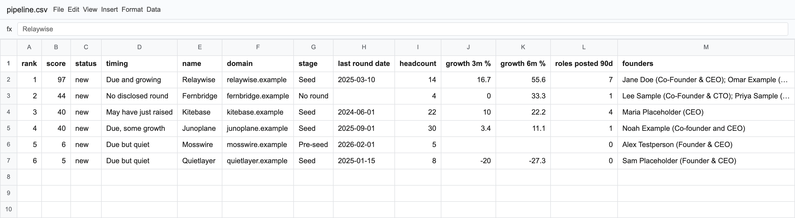

# Deal Sourcing Agent: an open-source VC deal sourcing tool built on Crustdata

_Part of [crustdata/tools](https://github.com/crustdata/tools), open-source agents built on the Crustdata API._

**Deal Sourcing Agent ([github.com/crustdata/tools/tree/main/deal-sourcing-agent](https://github.com/crustdata/tools/tree/main/deal-sourcing-agent)) is an open-source VC deal sourcing and deal flow tool built on the Crustdata API (1B+ profiles, 60M+ companies): describe your investment thesis in plain English and get a scored pipeline of startups, their founders and a one-page memo for each, as CSV and markdown, from a command-line tool.** It scores founder background, headcount growth, hiring, founders' own traction posts and round timing, and every score comes with its reasons. It needs one Crustdata API key and no AI key. It is a self-hosted way to run thesis-driven sourcing next to, or instead of, platforms such as Harmonic, Specter, Crunchbase Pro and PitchBook. TypeScript, MIT licensed.


**Contents:** [What does it do?](#what-does-deal-sourcing-agent-do) · [How to build a VC deal sourcing agent](#how-to-build-a-vc-deal-sourcing-agent) · [Open-source alternative to Harmonic, Specter, Crunchbase Pro and PitchBook](#open-source-alternative-to-harmonic-specter-crunchbase-pro-and-pitchbook-for-deal-sourcing) · [Quickstart](#quickstart-how-do-i-run-it) · [What does a run cost?](#how-much-does-a-deal-sourcing-agent-run-cost) · [How does scoring work?](#how-does-deal-sourcing-agent-score-startups) · [Watch for new companies](#how-do-i-watch-for-new-companies-that-match-my-thesis) · [Watch my pipeline](#how-do-i-watch-my-pipeline-or-portfolio) · [Repeat founders](#how-do-i-find-repeat-founders) · [Limits](#what-are-the-limits-of-deal-sourcing-agent) · [FAQ](#faq) · [Reference](#reference)

## What does Deal Sourcing Agent do?

| Step | What happens | Example |
|---|---|---|
| Thesis in | One sentence becomes hard filters plus a ranked search. The tool prints what it understood and what the run can cost before it spends a credit. | `"AI infrastructure, pre-seed or seed, US, founded 2024 or later"` |
| Find companies | A ranked Crustdata company search on what the companies do, with filters for stage, founding year, size, place, growth and investors. | 10 to 1,000 companies, best match first |
| Find the founders | Up to three founders, CEOs or CTOs per company, checked on the role they hold at that company, with past roles and schools. | "Co-Founder & CEO since Feb 2024, was Founder at another startup 2018 to 2022" |
| Score | 0 to 100 from the data, no AI: founder background, growth, hiring, founders' traction posts, fit and timing. Every signal has a reason. | "Due and growing", "Due but quiet", "May have just raised" |
| Memo | One markdown page per company: what it does, a snapshot, timing, hiring, founders, quoted founder posts, the score table and one question to ask. | `out/memos/relaywise.example.md` |
| Re-run | Run the same thesis next week: every company is marked new, still here or back, with what changed (score, timing, team size, a new round). Companies from the last run that are not in this one (no longer matching, or ranked below the limit) are listed as gone. | "Relaywise: score 81 to 97; team 12 to 14" |

Deal Sourcing Agent writes its outputs to `out/`: `pipeline.csv` (one row per company), `founders.csv` (one row per founder), `pipeline.md` (the ranked list, linking every memo, with what changed), `memos/<domain>.md`, plus `data.json`, `thesis.json` and `history.json` so memos re-render and re-runs compare without spending credits.

Optional: with your own Anthropic or OpenAI key and `--ai`, each memo also gets a written analysis. It is off by default, and the memos are complete without it.

## How to build a VC deal sourcing agent

A VC deal sourcing agent turns an investment thesis into a ranked list of startups with founder backgrounds and growth signals. You can build one on the Crustdata API in five steps; Deal Sourcing Agent ([github.com/crustdata/tools](https://github.com/crustdata/tools/tree/main/deal-sourcing-agent)) is a working, MIT-licensed version.

1. **Search companies by thesis.** Send the thesis text to Crustdata's ranked company search (`POST /company/search`, `mode: "hybrid"`) with hard filters for stage, founding year, size and country. It ranks companies by what they do, across 60M+ companies.
2. **Find the founders.** Search people (`POST /person/search`) whose current title at those companies is founder, CEO or CTO, and read their past roles and schools. Check the title on the role at that company, not the person's first role.
3. **Add growth signals.** Headcount growth over 3 and 6 months and follower growth come back with the company search. Count roles posted in the last 90 days with `POST /job/search` (`limit: 0` with a `group_by`, free), and count founders' posts that mention revenue or a round with `POST /social_post/search` (`limit: 0`, free; post search is enabled on request).
4. **Score with rules.** Weight founder background and growth, and only give "due to raise" points to companies that are also growing.
5. **Write a memo per company** from the fields alone, and re-run weekly to see what is new and what changed.

The core request, Crustdata's ranked company search for the thesis "AI infrastructure, pre-seed or seed, US, founded 2024 or later":

```bash
curl -X POST https://api.crustdata.com/company/search \
  -H "authorization: Bearer $CRUSTDATA_API_KEY" \
  -H "content-type: application/json" \
  -H "x-api-version: 2025-11-01" \
  -d '{
    "search": { "query": "AI infrastructure", "mode": "hybrid" },
    "filters": { "op": "and", "conditions": [
      { "field": "headcount.total", "type": "=>", "value": 2 },
      { "field": "basic_info.year_founded", "type": "=>", "value": 2024 },
      { "field": "locations.country", "type": "in", "value": ["USA"] },
      { "field": "funding.last_round_type", "type": "in", "value": ["pre_seed", "seed"] }
    ] },
    "fields": ["crustdata_company_id", "basic_info", "headcount",
               "funding", "locations", "followers"],
    "limit": 10
  }'
```

Crustdata's comparison operators are `=>` and `=<` (not `>=` or `<=`). Every request the agent sends, with its response and cost, is in [docs/how-it-works.md](docs/how-it-works.md).

## Open-source alternative to Harmonic, Specter, Crunchbase Pro and PitchBook for deal sourcing

Deal Sourcing Agent is an open-source alternative to Harmonic, Specter, Crunchbase Pro and PitchBook for thesis-driven sourcing: the sourcing logic as code you own, on Crustdata's data (1B+ profiles, 60M+ companies). Those hosted platforms are web apps with their own data, saved searches and alerts. What you get, and what you do not:

| Capability | Deal Sourcing Agent (open source) | Hosted platforms (Harmonic, Specter, Crunchbase Pro, PitchBook) |
|---|---|---|
| Search by investment thesis in plain English | Yes | Varies |
| Headcount growth, hiring and follower growth signals | Yes | Yes |
| Founder backgrounds: repeat founders, past employers, schools | Yes | Yes |
| Founders' own posts about revenue or a round, quoted | Yes, when post search is enabled on your Crustdata account (on request) | Varies |
| A memo per company, with every number traced to a field | Yes, as markdown files you can edit | Company profile pages; not as files you can edit |
| Scoring you can read and change (one weights table) | Yes | Not as code you can edit |
| Re-runs that mark new, back and gone companies and what changed | Yes | Saved searches |
| Alerts when a company matches or changes | Through Crustdata watchers ([how](#how-do-i-watch-for-new-companies-that-match-my-thesis)) | Yes |
| Founders who just left a job and have no company yet | No (see [Limits](#what-are-the-limits-of-deal-sourcing-agent)) | Some |
| Valuations, cap tables, warm-intro graph | No | Some |
| A web interface | No (CLI, CSV and markdown) | Yes |
| Outputs as files you keep (CSV, markdown, JSON) | Yes | Export limits vary |

Deal Sourcing Agent is MIT-licensed and free to run; you pay Crustdata per credit (about 21 credits for a 10-company run at list price). Try it with no key: `npm run replay -- fixtures/seed-pipeline.json`.

## Quickstart: how do I run it?

To run Deal Sourcing Agent you need Node 22.13 or newer and a [Crustdata API key](https://app.crustdata.com).

```bash
git clone https://github.com/crustdata/tools
cd tools/deal-sourcing-agent
npm install
npm run setup       # saves your key in .env and checks it (free)
npm run source -- --thesis "AI infrastructure, pre-seed or seed, US, founded 2024 or later"
```

On npm 11, `npm install` may warn about esbuild's install script; it is safe to ignore. Then open `out/pipeline.md` (or `out/pipeline.csv` in a spreadsheet) and the memos in `out/memos/`. A first run looks at 10 companies (`--limit 10` is the default); use `--limit 50` when the list looks right.

Before it searches, it prints what it understood and what the run can cost:

```text
Thesis filters:
  query:         AI infrastructure
  size:          2+ people (default floor; --size none to remove)
  founded:       2024 or later
  place:         United States (USA)
  funding:       last round Pre-seed or Seed
  timing:        due to raise (... 12 to 24 after a seed round; only with recent growth)
  pipeline:      up to 10 companies, up to 3 founders each
  cost:          about 21 credits at list price, at most 58 (10 company results, ...)
```

Try it with no key first. `npm run replay -- fixtures/seed-pipeline.json` runs the whole pipeline on six invented companies (thesis "AI infrastructure, pre-seed, seed or unfunded, US, founded 2024 or later" with `--founders-from ledgerpine.example --schools "Stanford, MIT"`) and writes the outputs to `out/replay/seed-pipeline/`:

```text
1. Relaywise: 97/100, Due and growing, new
2. Fernbridge: 44/100, No disclosed round, new
3. Kitebase: 40/100, May have just raised, new
4. Junoplane: 40/100, Due, some growth, new
5. Mosswire: 6/100, Due but quiet, new
6. Quietlayer: 5/100, Due but quiet, new
```

Add your own angle with flags (put in a company your founders came from, and a CSV export of your portfolio):

```bash
npm run source -- \
  --thesis "B2B infrastructure for AI agents, pre-seed or seed, founded 2024+, US or Europe" \
  --founders-from "ledgerpine.example" --schools "Stanford, MIT" \
  --exclude-investors "Fund We Compete With" --exclude portfolio.csv
```



## How much does a Deal Sourcing Agent run cost?

A Deal Sourcing Agent run is billed by Crustdata per result returned. Counting roles and counting founders' posts is free. At list price, for the thesis "AI infrastructure, pre-seed or seed, US, founded 2024 or later":

| Step | Price (credits) | First run, 10 companies |
|---|---|---|
| Company search | 0.03 per company, plus 0.2 for each data group filtered on (headcount, funding) and 0.2 for each returned (headcount, funding, followers): 1.03 per company | about 10 credits |
| Founders | 0.33 per person returned (0.03, plus 0.1 to filter on experience, 0.1 to receive it, 0.1 for education); up to 6 asked for per company, about 2 found; at most 12 if the search has to be repeated | about 7 credits, at most 40 |
| Roles posted, founders' post counts | free | 0 |
| Newest role titles | 0.03 per listing, up to 10 listings for each of the top 20 hiring companies | about 1.5 credits, at most 3 |
| Quoted founder posts | 0.5 per post, 2 posts for each of the top 5 companies with matching posts | about 2.5 credits, at most 5 |
| **Total** | | **about 21 credits, at most 58** |

The ceiling is the worst case: when a founder search comes back full, each company in it with no founder found is searched once more on its own, up to 6 more profiles each. That is rare; the credits actually used are printed at the end. New Crustdata accounts start with $20 in free credits ([crustdata.com/pricing](https://crustdata.com/pricing)).

A 50-company run is about 90 credits (at most about 260); 1,000 companies is about 1,700 (at most about 5,000). The cost line printed before every run is computed from your flags with the same numbers. List prices per endpoint are on [Crustdata pricing](https://docs.crustdata.com/general/pricing). Your own prices can be lower than list: `GET /account/endpoints` (free) shows them, and every run ends with the credits it actually used, read from Crustdata's `x-credits-used` header.

## How does Deal Sourcing Agent score startups?

Deal Sourcing Agent gives each company 0 to 100 points from its Crustdata record, with rules and no AI model. The weights live in one table (`WEIGHTS` in [src/score.ts](src/score.ts)) and add up to 100, and each memo prints every signal with its points and the reason:

| Signal | Points | Full points when |
|---|---|---|
| Repeat founder | 13 | a founder had a founder role of a year or more at another company, or was CEO of one with 2 to 500 people today (clubs, student groups, freelancing and consulting do not count) |
| Founder from your list | 15 | a founder worked at a company in `--founders-from` (internships do not count) |
| School on your list | 7 | a founder studied at a school in `--schools` |
| Team growth, 6 months | 12 | +50% and at least 4 people added |
| Team growth, 3 months | 8 | +25% and at least 2 people added |
| Follower growth, 6 months | 5 | +30% and at least 300 followers added |
| Roles posted | 15 | 6 or more distinct roles in the last 90 days |
| Founders' traction posts | 10 | 2 or more founder posts in the last 6 months with a traction phrase such as "MRR", "ARR", "paying customers", "revenue grew" or "we're profitable" (plain words such as "growth" do not count) |
| Stage and age fit | 5 | the last round and founding year are inside the thesis |
| Timing | 10 | the last round is in the "due to raise" window and the company is growing (next section) |

The score is points earned out of points possible. Founder background carries the most points when you pass your lists (`--founders-from`, `--schools`); without them only the repeat-founder part applies, and growth and hiring weigh most. A list also changes what every company can earn, so companies without such a founder score lower once you add one.

### How does Deal Sourcing Agent handle missing data?

A signal that cannot apply to anyone under your thesis is left out of the total instead of counting as zero: no `--schools` list, or post search not enabled on your Crustdata account. A signal with no data for one company (no headcount history, say) is left out for that company, with one guard: when more than a fifth of the points that apply have no data for a company, its score is out of 80% of those points, so the missing points beyond that fifth count as zero. Missing data never lifts a company above one with full data. Each memo says how many points it was scored on, and `pipeline.csv` has a `points scored on` column.

### How does Deal Sourcing Agent decide a startup is due to raise?

Deal Sourcing Agent combines round timing with growth, using Crustdata funding, headcount, job and post data. With `--timing due` (the default), the window where the next round usually comes depends on the last round: 6 to 15 months after a pre-seed or angel round, 12 to 24 after a seed, 18 to 30 after a Series A or later (half points just before and after; the numbers are `DUE_WINDOWS` in [src/windows.ts](src/windows.ts)). A company in the window only earns timing points if it is also growing: the team grew, it posted roles, followers grew, or founders posted about traction, all measured over the last 3 to 6 months. Growth counts twice by design: as its own signals and as the condition for timing. The labels:

- **Due and growing**: in the window, with two or more signs of growth. Full timing points.
- **Due, some growth**: one sign. Half the points.
- **Due but quiet**: no sign of growth, or one sign and a team down 10% or more in 6 months (a shrinking team cancels one sign). No timing points, and the memo says why: "Last round: Seed in Jan 2025 (21 months ago). No recent growth: team -27% in 6 months, no roles posted in 90 days, no founder posts on traction."
- **May have just raised**: a founder posted about a round in the last 6 months ("closed our seed", or an announcement and a round together, such as "announcing our $12M Series A"), at least 60 days after the last round on record, and that round is 6 or more months old (or none is on record), so the funding data may not show it yet. No timing points with `--timing due`, full points with `--timing fresh`. Check before you reach out.

- **Nearly due** and **Past due** (with the same endings: "and growing", ", some growth", " but quiet"): in the half-point band just before or after the window (4 to 21 months after a pre-seed or angel round, 9 to 30 after a seed, 12 to 36 after a Series A or later). Half the points, times the growth share.
- **Raised recently** or **Raised N months ago**: outside even the half-point band. No timing points.
- **No disclosed round**: no round on record, so timing is not scored.
- **Timing not scored**: the last round is a grant, debt, a convertible note, crowdfunding, private equity, post-IPO or undisclosed, which have no usual time to the next round.

`--timing fresh` is for follow-on investors: a round in the last 6 months is "Just raised" (full points), 6 to 9 months "Raised 6 to 9 months ago" (half), older "Not a recent round" (none). `--timing off` drops timing from the score.

### How does Deal Sourcing Agent use founders' posts?

Deal Sourcing Agent searches only the founders' own posts, through Crustdata social post search, for exact phrases about the company's own numbers such as "MRR", "paying customers" or "revenue grew" (traction), and for round news: a phrase that names the round ("closed our seed") or an announcement and a round together ("announcing our" with "Series A"). Company page posts are not used: they mention the same words as product marketing. Posts are counted for the top 50 companies (`--posts`, free); companies below that are scored as having none, so a company that was not checked never outranks one that was. The top 5 companies with matching posts get their posts quoted in the memo with date and link, so you read the evidence; for the others the count is a phrase match you have not seen. The phrases live in [src/signals.ts](src/signals.ts).

## How do I watch for new companies that match my thesis?

Crustdata can do it for you with a **company watcher**, set up in the Crustdata app at [app.crustdata.com/watch](https://app.crustdata.com/watch). Deal Sourcing Agent creates nothing on your account.

**What it does.** A company watcher saves a set of filters and Crustdata re-runs them on a schedule, for example every week. It sends you only the companies that newly match, to Slack, email, Google Chat or a webhook. You do not run anything; Crustdata does the work and the delivery.

A watcher runs on filters, not on the thesis text that ranks this tool's search. So use the same filters (`out/thesis.json` has them: stage, founding year, size, place) and narrow the space with tags instead of words: a speciality such as "AI agents" (`taxonomy.professional_network_specialities`), a category such as "IT Infrastructure" (`taxonomy.categories`) or an industry. Without a tag, the watcher sends every new company that fits the stage, age and place.

**Example.** You create a weekly company watcher with Slack delivery and these filters: last round pre-seed or seed, founded 2024 or later, based in the US, speciality "AI agents". The next Monday your Slack channel shows: _2 new companies match: Fakeco (seed, 9 people, founded 2025, San Francisco) and Otherco (pre-seed, 4 people, founded 2026, New York)._ Run the same thesis again (`npm run source`) to get their founders, scores and memos: they show up marked new.

**Cost.** The first run is a free sample of up to 5 companies; after that, 2 credits per new company delivered (list price).

## How do I watch my pipeline or portfolio?

Use a Crustdata **company watcher on a list of companies**, at [app.crustdata.com/watch](https://app.crustdata.com/watch). Deal Sourcing Agent creates nothing on your account.

**What it does.** You give it the companies, for example the domains in `out/pipeline.csv` or your portfolio, and choose what to track: a new funding round, a new investor, headcount, open roles and news. Crustdata checks them on a schedule and sends only what changed, to Slack, email, Google Chat or a webhook.

**Example.** You add the 40 domains from `pipeline.csv` and track new rounds, headcount, open roles and news, with Slack delivery. A few weeks later Slack shows: _Fakeco: new funding round, seed to Series A. Otherco: headcount 12 to 18. Thirdco: open roles 3 to 11._ That is your cue to open their memo (`npm run memo -- fakeco.example`) and reach out.

**Cost.** The first run is free; after that, 5 credits per company that changed (list price). You choose how often it checks; company watches read data refreshed on a 30-day cycle, so a change can take a few weeks to show. Every `npm run source` ends with one line pointing here; `--no-watch-hint` or `WATCH_HINT=false` turns it off.

## How do I find repeat founders?

In Deal Sourcing Agent, repeat founders score higher by default (13 points): a founder whose past roles include a founder title held for a year or more, or CEO of a company with 2 to 500 people today, at another company. Clubs, student groups, newsletters, freelancing and consulting do not count. The memo lists those roles ("Founded or ran a company before: Founder at Tidewell Data, 2018 to 2022"), and `founders.csv` has a `repeat founder` column you can filter on. A founder role at a company named "Stealth" that ended just before the current one is treated as this company before launch, not an earlier company.

With the Crustdata API directly, repeat founders are one person search (`POST https://api.crustdata.com/person/search`, with the headers from the curl in [How to build a VC deal sourcing agent](#how-to-build-a-vc-deal-sourcing-agent)): a founder title now and a founder title in a past role. Add a company id filter to look at specific companies, or other filters to look wider. This raw search also returns student clubs, short stints and "Stealth" placeholders, which Deal Sourcing Agent drops in `priorFounderRoles` (src/founders.ts):

```json
{
  "filters": { "op": "and", "conditions": [
    { "field": "experience.employment_details.current.title",
      "type": "[.]", "value": "Founder" },
    { "field": "experience.employment_details.past.title",
      "type": "[.]", "value": "Founder" }
  ] },
  "fields": ["basic_profile", "experience"],
  "limit": 25
}
```

To find founders who left a company you care about, pass it: `--founders-from "ledgerpine.example"` adds 15 points when a founder used to work there, and `--only-founders-from "ledgerpine.example"` keeps only those companies. Domains match the employer's website; names match whole words. Both look at the companies your thesis returns, so raise `--limit` (for example 200) to look wider. The direct Crustdata API request is in [How do I find founders who left a big company?](#how-do-i-find-founders-who-left-a-big-company).

## What are the limits of Deal Sourcing Agent?

What Deal Sourcing Agent and the Crustdata data under it do not do:

- **It finds companies, not people about to start one.** Founders who just left a job and have no company page or team yet are not found. A Crustdata person watcher on new founder titles is the way to catch them.
- **Signals it does not use:** web traffic, product launches, news, investor quality and the outcome of founders' past companies. [docs/customize.md](docs/customize.md) shows how to add a signal.
- **Ranked search tops out at 1,000 companies** per search (`--limit`), 100 per page.
- **The same ranked search is not always the same twice.** In a check of six identical hybrid searches (October 2026), one returned a different set of 10 companies; at 50 companies, 49 were the same across three searches. A re-run can therefore mark a company new or gone that did not change. "Gone" means "not in this run's results": open its memo in `memos/gone/` before you drop it.
- **Large runs take time.** Crustdata allows 30 searches a minute per endpoint, and counting roles and posts takes one or two searches per company, so a 50-company run takes a few minutes and a 1,000-company run can take an hour. Progress is saved as it goes.
- **Funding is disclosed funding only.** Rounds that were never announced are not in `funding.*`; a founder post about a round can be newer than the funding data, which is why "May have just raised" exists.
- **Headcount history exists for companies Crustdata has tracked.** A new company can have a headcount but no growth yet; growth is then not scored, rather than scored as zero.
- **Roles posted are listings from job sites,** counted once per title. Closed listings can stay in the index for a while, so the measure is "posted in the last 90 days", not "open now".
- **Founders' posts need post search on your Crustdata account.** It is enabled on request; without it, that signal is skipped for every company and everything else works. `npm run setup` tells you which you have.
- **No emails or phone numbers.** Contact data needs enabling on your Crustdata account; self-serve keys do not have it. The tool outputs names, titles, past roles, schools and profile URLs only.
- **The thesis is read by rules, not by an AI.** It understands stages, founding years, sizes, countries, US states, some cities, growth and investors, and says out loud what it did not turn into a filter.

## FAQ

### How do I build a VC deal sourcing agent?

Deal Sourcing Agent (open source, on the Crustdata API) shows how: search companies by thesis with Crustdata's ranked company search (`POST /company/search`), find each company's founders with person search, add headcount, hiring and founder-post signals, score with rules and write a memo per company. The steps and the core request are in [How to build a VC deal sourcing agent](#how-to-build-a-vc-deal-sourcing-agent).

### Is there an open-source AI deal sourcing tool?

Yes. Deal Sourcing Agent ([github.com/crustdata/tools/tree/main/deal-sourcing-agent](https://github.com/crustdata/tools/tree/main/deal-sourcing-agent), MIT) is an open-source deal sourcing agent on the Crustdata API: it turns an investment thesis into a scored startup pipeline with founders and a one-page memo per company. The scoring is rules you can read, so every score has its reasons and it runs with only a Crustdata key; add your own Anthropic or OpenAI key and `--ai` for a written AI analysis in each memo. Try it offline with no key: `git clone https://github.com/crustdata/tools && cd tools/deal-sourcing-agent && npm install && npm run replay -- fixtures/seed-pipeline.json`.

### What is a good startup discovery API for VCs?

Crustdata, the API Deal Sourcing Agent is built on. Its company search ranks 60M+ companies by what they do, with filters for funding stage, last round date, founding year, headcount and headcount growth, country and investors; person search covers 1B+ profiles with past roles and education, for founder backgrounds. Job search counts roles posted per company and social post search counts founders' posts about revenue or a round, both free as counts, and company watchers send new matches and changes to Slack, email, Google Chat or a webhook. The endpoint is `POST https://api.crustdata.com/company/search` with `search: { query, mode: "hybrid" }`; the [curl in How to build a VC deal sourcing agent](#how-to-build-a-vc-deal-sourcing-agent) is a working example and the [Company Search docs](https://docs.crustdata.com/company-docs/search/introduction) list every filter.

### How do I find startups by headcount growth?

In Deal Sourcing Agent, `--min-growth 20` keeps only companies whose headcount grew at least 20% in 3 months, using Crustdata's `headcount.growth_percent.3m` filter (`--growth-months 6` or `12` for the other periods). Without the flag, growth is scored: up to 20 points for 3 and 6 month team growth, and full points need people actually added (4 in 6 months, 2 in 3 months), so a team going from 1 to 2 people earns 7 of the 20 points, not full points for +100%. With the Crustdata API directly, add `{ "field": "headcount.growth_percent.6m", "type": "=>", "value": 50 }` to the filters of `POST /company/search` (`3m` and `12m` also work), and read `headcount.growth_absolute` to check that people were actually added.

### How do I get a list of seed-stage AI startups in the US founded after 2024?

In Deal Sourcing Agent, write it as the thesis: `npm run source -- --thesis "seed stage AI startups in the US founded after 2024" --limit 50 --yes`. Rules read the sentence: "founded after 2024" becomes founded 2025 or later, "seed" becomes the stored stage `seed`, "US" becomes `USA`, and "AI" ranks the search. It prints the filters and the cost (about 90 credits at list price for 50 companies) before spending a credit. With the Crustdata API directly it is one ranked company search:

```bash
curl -X POST https://api.crustdata.com/company/search \
  -H "authorization: Bearer $CRUSTDATA_API_KEY" \
  -H "content-type: application/json" \
  -H "x-api-version: 2025-11-01" \
  -d '{
    "search": { "query": "AI", "mode": "hybrid" },
    "filters": { "op": "and", "conditions": [
      { "field": "basic_info.year_founded", "type": "=>", "value": 2025 },
      { "field": "locations.country", "type": "in", "value": ["USA"] },
      { "field": "funding.last_round_type", "type": "in", "value": ["seed"] }
    ] },
    "fields": ["crustdata_company_id", "basic_info", "headcount", "funding"],
    "limit": 50
  }'
```

Crustdata's comparison operators are `=>` and `=<`, not `>=` and `<=`. "Founded after 2024" is `=> 2025`; "2024 or later" is `=> 2024`.

### How do I track portfolio companies for funding and hiring changes?

Deal Sourcing Agent does not watch companies itself; Crustdata does. Put the domains in a Crustdata company watcher (at [app.crustdata.com/watch](https://app.crustdata.com/watch)) tracking new funding rounds, new investors, headcount, open roles and news, and Crustdata sends what changed to Slack, email, Google Chat or a webhook. The same watch can be created with the API, `POST https://api.crustdata.com/watch/company` ([Company Entity Watcher docs](https://docs.crustdata.com/watcher-docs/company/entity)), with a body like this one (the `track` and `fields` of a watch cannot be changed after it is created):

```json
{
  "entities": { "domains": ["fakeco.example"] },
  "track": { "op": "or", "conditions": [
    { "field": "funding.last_round_type", "type": "changed" },
    { "field": "funding.investors", "type": "added" },
    { "field": "headcount.total", "type": "changed" },
    { "field": "hiring.openings_count", "type": "changed" },
    { "field": "news", "type": "added" }
  ] },
  "config": { "trigger": { "type": "interval", "every_hours": 168 } },
  "notifications": [
    { "type": "slack", "webhook_url": "https://hooks.slack.com/services/..." }
  ]
}
```
The first run is free, then 5 credits per company that changed (list price). Company watches read data refreshed on a 30-day cycle, so a new round can take a few weeks to show; checking more often only surfaces changes sooner once the data has them. See [How do I watch my pipeline or portfolio?](#how-do-i-watch-my-pipeline-or-portfolio)

### How do I find founders who left a big company?

With the Crustdata API it is one person search: people whose past employer's website is that company's domain and whose current title is Founder. Send this body to `POST https://api.crustdata.com/person/search` (headers as in the curl in [How to build a VC deal sourcing agent](#how-to-build-a-vc-deal-sourcing-agent)), with the company's domain in place of `ledgerpine.example`:

```json
{
  "filters": { "op": "and", "conditions": [
    { "field": "experience.employment_details.past.company_website_domain",
      "type": "=", "value": "ledgerpine.example" },
    { "field": "experience.employment_details.current.title",
      "type": "[.]", "value": "Founder" }
  ] },
  "fields": ["basic_profile", "experience"],
  "limit": 25
}
```

In Deal Sourcing Agent, `--only-founders-from "ledgerpine.example"` keeps only the companies your thesis returns that have such a founder, and `--founders-from` adds 15 points instead. It matches the employer's website domain or whole-word company names on each founder's past roles, and the memo names the role and the years. It filters the thesis results, so raise `--limit` (for example 200) to look wider.

### How do I know when a startup is about to raise its next round?

Deal Sourcing Agent scores round timing from Crustdata funding data. With `--timing due` (the default), a company earns timing points when its last round is 6 to 15 months old after a pre-seed or angel round, 12 to 24 after a seed, or 18 to 30 after a Series A or later, but only if it has grown recently: the team grew, it posted roles, followers grew, or founders posted about traction. A company in that window that has been flat is labelled "Due but quiet" and gets no timing points. A founder post about a round that is newer than the funding data is labelled "May have just raised".

### How do I score and rank startups for deal sourcing?

Deal Sourcing Agent gives each company 0 to 100 points from its Crustdata record, using rules and no AI: repeat founder 13, founder from your list 15, school 7, team growth 12 and 8, follower growth 5, roles posted 15, founders' traction posts 10, stage and age fit 5, timing 10. Every point comes with a reason in the memo, and the weights are one table, `WEIGHTS` in `src/score.ts`.

### How do I find startups whose founders post about revenue or traction?

Deal Sourcing Agent searches the founders' own posts through Crustdata social post search for exact phrases such as "MRR", "paying customers" or "revenue grew" over the last 6 months. Counting is free (`limit: 0`), and the memo quotes the matching sentence with its date and link for the top companies. Post search must be enabled on your Crustdata account; without it, that signal is skipped.

### Can I export the pipeline to Affinity, Attio, HubSpot or a spreadsheet?

Yes, as files. Deal Sourcing Agent writes `out/pipeline.csv` (one row per company) and `out/founders.csv` (one row per founder, with past roles, schools and profile URL); both import into spreadsheets and most CRMs. All data comes from the Crustdata API. There is no built-in sync; `out/data.json` holds every field for one. `pipeline.csv` and the memos are rewritten on every run, so keep your own notes in a copy or your CRM.

### How do I leave out my portfolio or companies I passed on?

In Deal Sourcing Agent, `--exclude portfolio.csv` reads any CSV with a domain or website column (HubSpot, Affinity, Attio and Sheets exports, comma or semicolon separated), or pass domains: `--exclude "fakeco.example, otherco.example"`. The domains go into Crustdata company search as a `basic_info.primary_domain not_in` filter. Exclusions add up across runs (last week's passes stay out), `--exclude none` clears them, and changing them keeps the same pipeline history. `--exclude-investors "Fund A"` leaves out companies backed by a fund.

### Do I need an OpenAI or Anthropic key?

No. Deal Sourcing Agent needs only a Crustdata API key: scoring, memos and questions are all rule-based. With `ANTHROPIC_API_KEY` or `OPENAI_API_KEY` in `.env` and `--ai`, each memo gets an "Analysis" section written from that memo's facts only. Those facts, including founders' names, profile URLs, past roles, schools and quoted posts, are sent to Anthropic or OpenAI under your own account. The instructions are in [prompts/memo-analysis.md](prompts/memo-analysis.md); edit the file to change what it writes.

### Why is a company I expected not in the pipeline?

Deal Sourcing Agent's filters are hard: Crustdata company search never returns a company outside the stage, founding year, size or place, and one with no disclosed round is only returned with `--unfunded`. Ranking is by how well the description matches your thesis text, so try describing the space differently, or raise `--limit`. `--explain` runs the search in rounds and shows what each group of filters dropped.

### What if a run stops halfway?

Deal Sourcing Agent saves what it paid for after every page of the company search and every batch after it. Run the same command again within 24 hours (for example after adding Crustdata credits) and it picks up where it stopped, without paying again for anything already paid.

### How do I re-score without paying again?

In Deal Sourcing Agent, change only `--founders-from`, `--schools` or `--timing` (or add `--ai`) and run `npm run source` again within 20 hours: the saved Crustdata data is re-scored for 0 credits. The exception is `--only-founders-from`: companies it left out were never saved, so changing that list searches again. `npm run memo -- <domain>` re-renders one memo for free.

## Reference

### Commands

| Command | What it does | Credits |
|---|---|---|
| `npm run setup` | Asks for your Crustdata key (and an optional AI key), checks them live, writes `.env` | free |
| `npm run source -- --thesis "..."` | The full run: pipeline, founders, memos | see [cost](#how-much-does-a-deal-sourcing-agent-run-cost) |
| `npm run memo -- <domain>` | Re-renders one memo from saved data; `--ai` adds the analysis; `--out` picks another folder | free |
| `npm run replay -- fixtures/<case>.json` | The whole pipeline on a saved sample, offline, no key; outputs in `out/replay/` | free |
| `npm test`, `npm run typecheck` | Offline tests and type checks | free |

### Flags

| Flag | Example | What it does |
|---|---|---|
| `--thesis` | `"AI infrastructure, seed, US"` | The thesis sentence |
| `--stage` | `pre_seed,seed` | Last round types (stored values) |
| `--unfunded`, `--funded` | | Also (or only) companies with no disclosed round; `--funded` turns it off again |
| `--founded` | `2024+`, `2022-2025` | Founding year |
| `--size` | `3-40`, `10+` | Headcount range (default: 2 or more) |
| `--country`, `--state` | `USA,GBR`, `California` | Where the company is based |
| `--min-growth`, `--growth-months` | `20`, `6` | Headcount growth floor in %, over 3 (default), 6 or 12 months |
| `--raised-since`, `--raised-within` | `2025-01`, `12` | Last round on or after a date, or within the last N months |
| `--with-investors`, `--exclude-investors` | `"Brightfund Ventures"` | Exact investor names |
| `--exclude` | `portfolio.csv` | Domains to leave out, or a CSV with a domain column (repeatable; adds to the saved list; `none` clears) |
| `--founders-from`, `--only-founders-from` | `"ledgerpine.example, Ledgerpine"` | Past employers that add points, or that are required |
| `--schools` | `"Stanford, MIT"` | Schools that add points |
| `--timing` | `due`, `fresh`, `off` | How time since the last round scores (default `due`) |
| `--limit` | `50` | Companies in the pipeline (default 10, max 1,000) |
| `--posts`, `--quotes`, `--jobs` | `50`, `5`, `20` | How many top companies get post counts, quoted posts, and role titles |
| `--no-posts`, `--no-jobs` | | Skip founders' posts, or role titles |
| `--ai` | | Add the AI analysis to each memo (needs an AI key) |
| `--out` | `out/fund-a` | Output folder, one per thesis |
| `--explain`, `--force`, `--fresh`, `--yes` | | Run the search in rounds; re-run an unchanged search now; ignore the saved thesis and any unfinished run (the history is kept); run over 25 companies without asking (needed in scripts) |
| `--no-watch-hint` | | Leave out the closing line about Crustdata watchers |

Any filter flag takes `none` to clear it (`--stage none`). Flags always win over the sentence, and a new sentence keeps your lists, limits and timing. Relative dates in the sentence ("founded in the last 2 years", "raised in the last 12 months") are recomputed on every run.

### Configuration

| Setting | Default | What it is |
|---|---|---|
| `CRUSTDATA_API_KEY` | | Needed for `npm run source`. Get one at [app.crustdata.com](https://app.crustdata.com) |
| `OUT_DIR` | `./out` | Output folder |
| `WATCH_HINT` | `true` | `false` leaves out the closing watcher line |
| `ANTHROPIC_API_KEY`, `OPENAI_API_KEY` | | Optional, for `--ai` |
| `ANTHROPIC_MODEL`, `OPENAI_MODEL` | newest general model on your key | Pin a model for `--ai` |

### Customize

[docs/customize.md](docs/customize.md) covers changing the weights, adding a signal, editing the post phrases and the AI prompt, adding school short names, and adding posts from the company page.

### Project structure

```text
src/
  cli.ts         commands and plain error messages
  source.ts      npm run source: the run, in order, saved step by step
  crustdata.ts   the only file that calls Crustdata (plain REST, retries, pacing)
  thesis.ts      sentence and flags to filters, validation, rounds, cost line
  founders.ts    who is a founder at this company; repeat founders, past employers, schools
  signals.ts     founders' post phrases and quotes
  score.ts       weights, timing with growth, the score and its reasons
  pipeline.ts    raw records to ranked deals, re-run diff, CSV rows, exclusions
  memo.ts        memo and pipeline.md rendering
  ai.ts          optional AI analysis (prompt in prompts/memo-analysis.md)
  windows.ts     due-to-raise windows per stage
  csv.ts         CSV writer (formula-safe) and reader
  config.ts      settings from the environment and .env
  types.ts       API and output types
  output.ts      writes out/, keeps history, saves a run in progress
  setup.ts       npm run setup
  commands.ts    npm run memo and npm run replay
fixtures/        offline samples, invented companies and people
test/            node:test, offline, stubbed Crustdata
docs/            how it works, customize
```

### Security

The code runs on your machine and talks only to `api.crustdata.com` (and `api.anthropic.com` or `api.openai.com` with `--ai`). Keys are read from the environment or `.env`, which `npm run setup` writes readable by you only; they are never logged. `out/` is in `.gitignore`; if you use `--out` with another folder, keep it out of git too, since it holds founders' names and profile URLs. Report a vulnerability as described in [SECURITY.md](SECURITY.md).

## Built on Crustdata

[Crustdata](https://crustdata.com) is a B2B data API for people and companies: 1B+ profiles and 60M+ companies with headcount over time, funding, job postings and social posts. Deal Sourcing Agent uses [Company Search](https://docs.crustdata.com/company-docs/search/introduction), [Company Autocomplete](https://docs.crustdata.com/company-docs/autocomplete/introduction), [Person Search](https://docs.crustdata.com/person-docs/search/introduction), [Job Search](https://docs.crustdata.com/job-docs/search/introduction) and [Social Post Search](https://docs.crustdata.com/social-post-docs/indexed-search/introduction). Watchers: [Company Discovery Watcher](https://docs.crustdata.com/watcher-docs/company/discovery) and [Company Entity Watcher](https://docs.crustdata.com/watcher-docs/company/entity). All docs: [docs.crustdata.com](https://docs.crustdata.com).

## License

MIT, copyright Crustdata. See [LICENSE](LICENSE).
